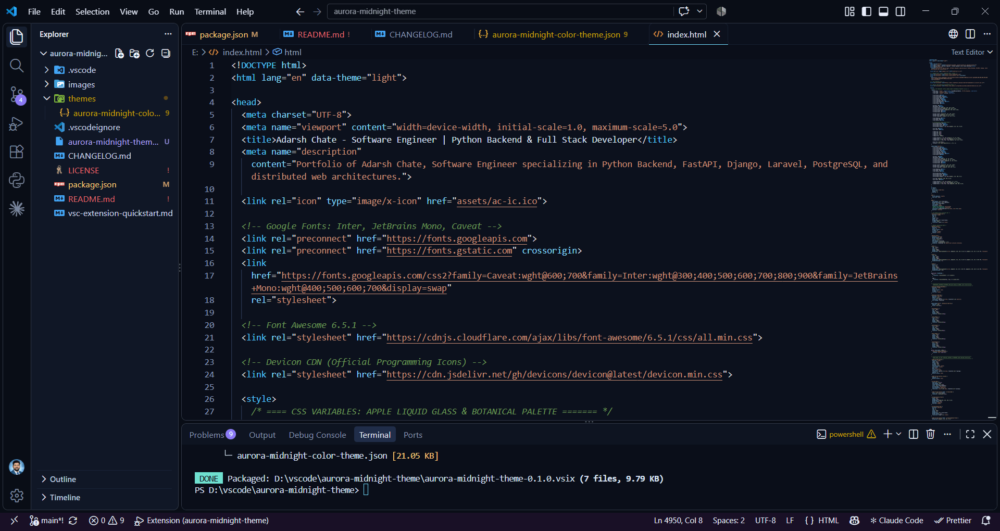

# Aurora Midnight Theme

A premium dark theme for Visual Studio Code, featuring midnight navy surfaces, electric blue highlights, violet accents, and familiar syntax highlighting designed for focused development.

Aurora Midnight brings a refined, modern aesthetic to your coding environment while preserving the recognizable syntax colors developers are accustomed to.


## Preview



## Features

- **Midnight dark palette** — Deep navy and charcoal backgrounds designed for a focused coding experience.
- **Electric blue accents** — Clear visual emphasis for active and interactive interface elements.
- **Violet and cyan details** — Subtle secondary accents that complement the dark palette.
- **Familiar syntax highlighting** — Colors inspired by the established VS Code Dark+ conventions.
- **Semantic highlighting** — Semantic token colors for languages and extensions that support it.
- **Coordinated workbench colors** — Theme colors for supported editor surfaces, tabs, sidebars, panels, menus, terminal elements, and diagnostics.
- **Developer-focused design** — A restrained visual style intended for everyday programming and longer coding sessions.

## Installation

### Install from the Visual Studio Code Marketplace

Once Aurora Midnight is published:

1. Open Visual Studio Code.
2. Open the Extensions view with `Ctrl+Shift+X`.
3. Search for **Aurora Midnight Theme** or **Aurora Midnight**.
4. Select the extension published by `adarshchate`.
5. Click **Install**.
6. Open the Command Palette with `Ctrl+Shift+P`.
7. Run `Preferences: Color Theme`.
8. Select **Aurora Midnight**.

### Install from a VSIX package

You can also install the extension from a locally generated VSIX package.

1. Open the Extensions view in VS Code.
2. Select the **More Actions** (`...`) menu.
3. Choose **Install from VSIX...**.
4. Select the generated `aurora-midnight-theme-0.1.0.vsix` file.
5. Open `Preferences: Color Theme` and select **Aurora Midnight**.

## Recommended Settings

Aurora Midnight works as a color theme without additional configuration. The following optional settings can complement its appearance.

Open your VS Code `settings.json` and add or merge these settings with your existing configuration:

```json
{
  "workbench.colorTheme": "Aurora Midnight",
  "editor.fontFamily": "JetBrains Mono, Consolas, monospace",
  "editor.fontSize": 14,
  "editor.lineHeight": 22,
  "editor.fontLigatures": true
}
```

**Note:** JetBrains Mono is an optional font and must be installed separately. If it is unavailable, VS Code will use the next available font in the list.

These settings are suggestions, not requirements. Adjust the font size, line height, and other editor preferences to suit your workflow.

## Color Palette

Aurora Midnight uses a dark foundation with cool, luminous accent colors.

| Role | Design direction |
|---|---|
| Main editor | Deep charcoal and midnight navy |
| Workbench surfaces | Layered dark neutral tones |
| Primary accents | Electric blue |
| Secondary accents | Violet and cyan |
| Syntax highlighting | Familiar VS Code Dark+ conventions |
| Diagnostics | Distinct warning, error, and informational colors |

Exact colors can vary by UI component and syntax token. The theme's JSON file defines the actual color values.

## Design Philosophy

Aurora Midnight is designed around four principles.

### 1. Focus

Dark editor surfaces help maintain a consistent visual environment without unnecessary decoration.

### 2. Clarity

Syntax highlighting and interface accents are intended to make important code elements and active UI states easy to distinguish.

### 3. Consistency

Related workbench components use a coordinated palette, while familiar syntax conventions help keep code recognizable.

### 4. Modern aesthetics

Midnight navy, blue, violet, and cyan accents create a restrained futuristic appearance inspired by contemporary glass-like interfaces.

## Language Support

Aurora Midnight uses the VS Code color theme API, TextMate token scopes, and semantic token colors.

Its appearance can vary according to:

- The programming language being edited.
- The installed language extension.
- Semantic highlighting support.
- Custom editor settings.
- Additional syntax tokens supplied by extensions.

For the best experience, test the theme with the languages and tools you use most frequently.

## Theme Limitations

Aurora Midnight is a declarative VS Code color theme, not a custom workbench implementation.

The VS Code theme API controls supported interface colors and syntax highlighting. A color theme alone cannot fully redesign the native workbench layout, add arbitrary rounded corners to every component, or place a custom wallpaper behind the native editor.

Some glass-inspired styling must therefore be approximated through supported colors rather than custom structural UI changes.

## Accessibility

Color appearance depends on your display, environment, and visual needs.

When evaluating Aurora Midnight, check:

- Code readability and syntax distinctions.
- Text contrast against editor backgrounds.
- Active selections and highlighted lines.
- Error, warning, and informational diagnostics.
- Terminal output and integrated panels.
- Focused and unfocused editor states.

If a color combination makes an element difficult to read, feedback is welcome.

## Troubleshooting

### The theme does not appear in the theme picker

1. Confirm that Aurora Midnight is installed and enabled.
2. Run `Developer: Reload Window` from the Command Palette.
3. Run `Preferences: Color Theme` again and search for Aurora Midnight.

### Some syntax colors look different

Language extensions can contribute their own TextMate scopes or semantic tokens. The final appearance may differ between languages and extensions.

### The editor font has not changed

Font settings are separate from the color theme. Install your preferred font and configure `editor.fontFamily` in VS Code settings.

## Feedback and Support

If you discover a theme issue or have a suggestion, please use the support or issue-reporting link provided on the extension's Marketplace page, when available.

When reporting an issue, include:

- Your VS Code version.
- The affected programming language or interface element.
- A screenshot showing the issue, if possible.
- Relevant language extensions or custom settings.

## Changelog

See [CHANGELOG.md](CHANGELOG.md) for release notes and updates.

## License

Aurora Midnight Theme is distributed under the MIT License. See the [LICENSE](LICENSE) file for the full license text.

---

**Aurora Midnight Theme** — a focused, modern dark workspace for developers.

Created by **Adarsh Chate**.